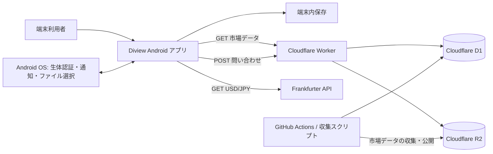
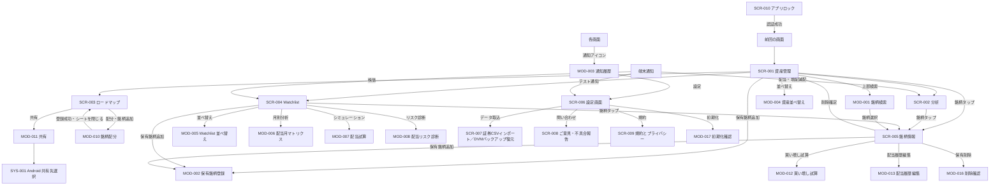

# Diview 現行仕様（As-Is）

- 基準日：2026-10-18
- 対象：現行の Android ネイティブアプリと、アプリが参照するデータ/API・端末内処理。運用管理者向け API は連携仕様として記録し、管理画面は対象 UI に含めない。
- 現行ソース：`kurogane-dividend/android/`。`kurogane-dividend/src/` は必要に応じた挙動参照であり、Android のビルド元ではない。`archive/` は対象外。
- 記述根拠：現行ソース、リポジトリ内の `ai_docs/`、および本文に日時を付した本番 GET 応答。
- 確認区分：**コード確認**はチェックアウト内の実装、**本番応答確認**は記載時刻の読み取り専用 HTTP 応答を示す。端末上の全操作を実行した受入試験ではない。

> 本書は現時点で確認できた仕様の記録である。記載時刻を越えた本番データの状態、端末や OS バージョン固有の表示差、およびソースから一意に決まらない挙動は【要確認】とする。

## 1. システム全体概要

### 1.1 アプリケーション概要

Diview は、個人が日本株・米国株・投資信託の保有状況、配当見込み、配当履歴、監視銘柄を端末上で管理・分析する Android アプリである。配当受取の月別分析、保有資産の構成、配当目標までのロードマップ、銘柄ごとの財務・配当情報を表示する。

ポートフォリオ、設定、監視銘柄などの主データは端末内に保持する。株価・銘柄情報等は Cloudflare Worker API から取得し、問い合わせフォームは同 API に送信する。アプリの通常利用に会員アカウント作成やログインはない。

### 1.2 主要アクターと権限

| アクター | 認証・識別 | 主な操作・権限 |
|---|---|---|
| 端末の利用者 | Diview の会員ログインなし。アプリデータは端末内に保存 | 保有銘柄、監視銘柄、設定、配当履歴の編集、CSV/DVM の入出力、問い合わせ送信 |
| 端末を利用する第三者 | アプリ内アカウントによる権限区分なし | 生体認証・端末資格情報のロックが有効な場合、端末認証が通るまでロック画面に留まる |
| データ収集・公開処理 | GitHub Actions、Cloudflare Worker、R2/D1 のサービス設定 | 市場データの収集・公開、スケジュール実行。通常の Android 利用者に管理権限を付与しない |
| 運用管理者 | Worker の管理 API に `X-Admin-Secret` を付けるサーバー側認証 | ソースに定義された運用・管理 API。資格情報はアプリに含めない |

プレミアム会員、店舗管理者、一般会員などのアプリ内ロールは確認できない。Worker ソースにはクライアント登録とクライアント認証の API があるが、Android UI のログイン・登録フローとは接続されていない。

### 1.3 構成とデータ境界

Android アプリの application ID は `com.kurogane.dividend`。アプリは `minSdk 26`、`targetSdk 36`、Java/Kotlin 17 を使用する。マニフェストにはインターネット、通知、生体認証、起動完了通知の権限が定義されている。アプリの cleartext HTTP は無効、`allowBackup` は有効。

### 1.4 確認済み範囲と本番との差分

- Worker のチェックアウト内ソースは、現行 v2 系の市場データ経路を定義する。
- 2026-10-15 13:30:13 UTC の読み取り専用本番確認では、`/api/v1/health` は HTTP 200、D1 と market storage は利用可能と報告した。一方、最新 snapshot は 2026-10-10 08:31:40 UTC、`market_data_date` は 2026-10-09、snapshot age は約 5.207 日、`stale_after_days` は 3 日だった。live quote は 194 件、refresh date は 2026-10-12。取得バッチ総数 1980、enqueued 100、completed 100、failed_batches 3、status `running`。同時刻の最新 scheduled run は `running`、processed 0、failed 0。
- 同時刻に `/api/v1/live-quotes?codes=7203` は `legacy_unpublished: true`、`complete: false`、空の items を返した。`/api/v1/search-catalog` は `schema_version: 1` の旧形式データを返し、`/api/v1/security-search?q=7203` は銘柄コードと名称だけを返した。`/api/v1/share-split-history` は HTTP 404。
- この結果は上記日時の本番応答に限る。リポジトリ内ソースと本番 Worker のデプロイ内容・公開データには差があるため、本書では「コード上の実装」と「本番で観測した応答」を混同しない。

本番 API の個別応答（同日同時刻帯の読み取り確認）：

| リクエスト | 応答 | 確認できた範囲 |
|---|---|---|
| `/api/v1/search-catalog` | 200、`schema_version: 1`、`generated_at: 2026-10-14T01:14:24.507Z` | 旧カタログ。全市場・全銘柄の完全性を示さない |
| `/api/v1/security-search?q=7203` | 200、7203「トヨタ自動車」 | 検索候補。quote fields は含まない |
| `/api/v1/live-quotes?codes=7203` | 200、空 items、`legacy_unpublished: true`、`complete: false` | v2 live quote は公開されていない応答 |
| `/api/v1/securities/7203` | 200、旧 D1 経路 | トヨタの旧年次 DPS 値95等を含む。v2 live quote の代替確認ではない |
| `/api/v1/financial-data/7203` | 200、旧年次データ | 銘柄の財務／配当履歴応答がある |
| `/api/v1/dividend-months?symbols=7203.T` | 200、`as_of: 2026-10-15`、月[3,9] | 2026-03-30・2026-09-29 の各50の観測イベント。`final_rights_date` と `record_date` は null、今後のイベントなし |
| `/api/v1/monthly-price-history?codes=7203&months=2025-12` | 200 | 2025-12-30 の終値3356を返した |
| `/api/v1/share-split-history?...` | 404 | 当該本番経路は未公開または不在 |

## 2. 画面一覧および画面遷移

### 2.1 サイトマップ

| ID | 画面・要素 | 種別 | 入口 |
|---|---|---|---|
| SCR-001 | 資産管理 | メイン画面 | 起動時、下部タブ |
| SCR-002 | 分析（配当分析／増配減配／構成銘柄） | メイン画面内の3ページ | 下部タブ、横スワイプ |
| SCR-003 | ロードマップ | メイン画面 | 下部タブ |
| SCR-004 | Watchlist | メイン画面 | 下部タブ |
| SCR-005 | 銘柄情報 | 詳細画面 | 銘柄行・検索結果をタップ |
| SCR-006 | 設定画面 | メイン階層画面 | 上部設定アイコン、通知履歴から設定 |
| SCR-007 | 「証券CSVインポート」／「DVMバックアップ復元」 | サブ画面 | 設定から遷移。選択中のモード名を上部に表示 |
| SCR-008 | ご意見・不具合報告 | サブ画面 | 設定から遷移 |
| SCR-009 | 規約とプライバシー | サブ画面 | 設定から遷移 |
| SCR-010 | アプリロック／OS 認証プロンプト | 条件付き画面・OS UI | 生体認証ロック有効時の起動・復帰 |
| MOD-001 | 銘柄検索シート | モーダルボトムシート | 上部検索、監視銘柄追加など |
| MOD-002 | 保有銘柄登録シート | モーダルボトムシート | 資産管理、Watchlist、銘柄情報 |
| MOD-003 | 通知履歴シート | モーダルボトムシート | 上部通知アイコン |
| MOD-004 | 資産管理の並べ替えシート | モーダルボトムシート | 資産管理の並べ替え操作 |
| MOD-005 | Watchlist の並べ替えシート | モーダルボトムシート | Watchlist の並べ替え操作 |
| MOD-006 | Watchlist の配当月・構成マトリクス | モーダルボトムシート | Watchlist の分析カード |
| MOD-007 | Watchlist の配当シミュレーション | モーダルボトムシート | Watchlist の月別分析カード |
| MOD-008 | Watchlist の配当リスク診断 | モーダルボトムシート | Watchlist の診断操作 |
| MOD-009 | Watchlist の説明ダイアログ | ダイアログ | カレンダー／ヒートマップ等の情報アイコン |
| MOD-010 | ロードマップ銘柄配分シート | モーダルボトムシート | ロードマップの追加・配分操作 |
| MOD-011 | ロードマップ共有シート | モーダルボトムシート | 「達成状況を共有」 |
| MOD-012 | 銘柄情報の買い増しシミュレーター | モーダルボトムシート | 銘柄情報画面 |
| MOD-013 | 配当金の推移を編集 | モーダルボトムシート | 銘柄情報の配当履歴編集 |
| MOD-014 | 株主優待編集 | 画面内編集領域 | 銘柄情報の優待セクション |
| MOD-015 | 銘柄分析の説明 | ダイアログ | 銘柄情報の説明アイコン |
| MOD-016 | 保有銘柄削除確認 | ダイアログ | 銘柄情報から保有銘柄を削除 |
| MOD-017 | 全データ初期化確認 | ダイアログ | 設定の初期化操作 |
| SYS-001 | Android 通知権限、ドキュメント選択、共有先選択、端末セキュリティ設定 | OS UI | アプリから権限要求・入出力・共有を実行 |
| UI-001 | Snackbar／Toast | 一時表示要素 | 削除、Undo、保存・通信エラーなど |

`AssetManagementScreen` 内には追加用ダイアログとクイック編集シートのソースがあるが、初期値が閉状態で、当該状態を開くイベントは現行呼び出し経路から確認できない。`AnnualDividendScreen` の `AssetTrackingSection` も関数定義はあるが呼び出し箇所がなく、資産推移の月次価格表示は現行画面から到達できない。`ExDividendMatrixDialog` も宣言はあるが呼び出し元が見つからない。これらは到達可能な画面要素として数えず、【要確認】実機からの到達手段が別に存在するかは本書のコード確認範囲では判別できない。

### 2.2 画面遷移

- 起動ルートは `asset`。下部タブは「資産管理」「分析」「ロードマップ」「Watchlist」。設定画面にも下部バーは表示されるが、タブの選択表示は設定専用状態にならず先頭位置を使う。
- 下部タブ切替時は現在のサブ画面を戻してからタブを選択する。タブ状態を保存・復元する。選択中の「分析」「ロードマップ」「Watchlist」を再タップすると先頭へスクロール要求を送る。「資産管理」の再タップに同じ要求を送る処理はない。
- 「銘柄情報」「証券CSVインポート」「DVMバックアップ復元」「ご意見・不具合報告」「規約とプライバシー」では下部タブを隠す。画面遷移アニメーションは slide + fade、300 ms。
- 上部検索・通知アイコンはメイン階層に表示される。設定画面では検索・通知を出さない。
- Android 戻る操作はナビゲーションスタックを戻る。シート／ダイアログは OS/Compose の閉じる操作を受け付ける。

## 3. 機能要件・画面別詳細仕様

### 共通仕様

- 市場データの GET は `CloudflareMarketRepository` を通す。HTTPS のみ、リダイレクトを追わず、接続タイムアウト 8 秒、読み取りタイムアウト 12 秒、応答本文上限 8 MiB。2xx 以外は HTTP エラーとして扱う。ただし、機能ごとに 404 を「データなし」とする例外がある。
- 問い合わせ・為替取得の `ServiceHttp` は HTTPS のみ、リダイレクトなし、接続 8 秒、読み取り 12 秒。POST 本文 100,000 bytes、応答本文 1,000,000 bytes を上限とする。
- アプリ内のログインセッションや会員認可はない。市場データ GET はアプリから資格情報を送らない。問い合わせ POST はサーバー側レート制限の対象。
- 一時的な検索/API失敗で既存のローカル保有数量をサーバー値に置換しない。価格更新失敗時は保存値を保持し、次回起動時等の更新機会を待つ。
- 銘柄検索カタログの補助キャッシュはアプリメモリー上で5分間有効。`/api/v1/financial-data/{code}` の404は該当箇所で「データなし」へ変換する。
- 市場 API の他の 4xx/5xx、HTTP タイムアウト、名前解決等の通信エラーは機能ごとの失敗 state に渡す。統一した再試行・ダイアログ表示はない。問い合わせ／為替 `ServiceHttp` は 429 で「送信回数の上限に達しました。時間をおいて再試行してください。」、400/413 で「入力内容を確認してください。」、その他の HTTP エラーで「サーバーへ接続できませんでした。再試行してください。」を返す。
- 401 は Worker 管理 API 等の認可エラーであり、一般利用の Android 市場データ画面にはログイン・セッション更新フローがない。
- `【要確認】`が付く入力上限・端末挙動は、現行ソースから明示的に確定できない。未指定の文字数上限や文字省略規則を推定しない。

### SCR-001 / 資産管理

#### 3.1 画面概要

端末に登録した保有銘柄の評価額、取得額、損益、配当見込みを確認し、月・市場区分で絞り込む画面である。

#### 3.2 UIコンポーネント・要素一覧

- 上部タイトル・説明、金額表示のマスク切替、検索アイコン、通知履歴アイコン、設定アイコン。
- 「総資産評価額」「年間配当目安」「平均配当利回り」等のサマリー、年間配当目標、月別配当グラフ／目標表示、直近の配当受取予定。
- 月フィルター、銘柄区分フィルター（日本株・米国株・投資信託）、銘柄検索入力（銘柄コード・銘柄名・セクターで検索）。
- 並べ替え操作と銘柄一覧。行には銘柄名・コード、株価、保有数、評価額、取得額／損益、配当関連値を表示する。
- 銘柄行の4指標は、配当利回り、年間配当額、直近の年次増減率・増減額、保有株数・単価を表示する。年間配当額が0以下の場合は「¥0/年」と表示する。直近の連続した年次履歴がなく増減率・増減額を計算できない場合も、表示値は「0.0%」「年額 ¥0」となる。
- 保有銘柄登録の入口。銘柄行のタップは「銘柄情報」へ遷移する。
- 削除時のアニメーションと、削除取り消し用の Snackbar「元に戻す」。
- 下部タブ。

#### 3.3 入力バリデーション・制約条件

| 項目名 | 型/文字数制限 | 必須/任意 | バリデーションルール | エラー時の表示メッセージ・挙動 |
|---|---|---|---|---|
| 銘柄検索 | 文字列。明示的な最大長なし | 任意 | 銘柄コード、表示名、業種に部分一致。大文字小文字を無視 | 入力に応じて一覧を絞る。入力上限は【要確認】 |
| 月・市場区分 | 選択値 | 任意 | 画面内の選択肢から選ぶ | 該当行がない場合の専用メッセージ詳細は【要確認】 |

保有数量・取得単価の登録ルールは MOD-002 を参照。

#### 3.4 正常系ユースケース・処理ロジック

1. 起動後、暗号化ローカル保存データから保有銘柄を復元する。
2. 保存済みデータに基づきサマリーと一覧を表示する。市場データ更新は ViewModel の起動時更新制御に従う。
   - 銘柄行の年間配当額は保有数・有効な1株配当額等から計算する。配当月が未取得の場合は「配当月未取得」と表示する。
   - 年次増減指標は取得済みの隣接する連続2年を比較する。比較対象がない状態は内部では未計算だが、行の表示は「0.0%」「年額 ¥0」となるため、この表示だけでは実績ゼロと履歴不足を区別できない。
3. 月・区分・検索条件を変更すると、表示中の一覧をローカルで絞り込む。
4. 並べ替えは評価額、損益、利回り、配当額、コードと昇順・降順を選び、適用時に一覧へ反映する。
5. 銘柄行をタップすると `detail/{code}` へ遷移する。
6. 削除操作後に保有データを更新し、Snackbar の「元に戻す」が選ばれた場合に対象銘柄を復元する。

#### 3.5 異常系・例外処理・エラーハンドリング

- ローカル復元エラー時の ViewModel は保存エラー状態を保持する。保有内容の復元に失敗した状態で正常な保有一覧が表示されるとは限らない。
- 株価等の GET が失敗した場合、既存の価格値を保持する。未取得・取得失敗・確認済みゼロ配当を同一状態として扱わない。
- オフライン時も保存済みポートフォリオとローカル絞り込みは利用できる。未取得データの取得・更新はできない。
- API の 4xx/5xx、タイムアウト時の画面ごとの専用文言は取得処理ごとに異なる。【要確認】全エラーコードを同一ダイアログへ集約する共通動作はない。
- 削除 Undo の表示時間は Snackbar の `Short`。アプリ終了をまたいだ Undo は実装されていない。

#### 3.6 画面固有のステート（状態管理）

- 保有データの復元完了・合計額アニメーション状態。
- 月・銘柄区分・検索文字列。
- 適用中／編集中の並べ替え条件。初期条件は評価額・降順。
- 削除中銘柄、削除後の次行、復元中銘柄、Undo後の復元スクロール対象。
- ファイル内に追加ダイアログ／クイック編集用 state が定義されているが、現行経路から開く操作は確認できない。

### SCR-002 / 分析（配当分析・増配減配・構成銘柄）

#### 3.1 画面概要

保有銘柄を集計し、配当、銘柄ごとの増配・減配、資産構成を3ページで確認する。ページ初期値は「配当分析」。タップ／横スワイプでページを切り替える。

#### 3.2 UIコンポーネント・要素一覧

- 共通ヘッダー、3ページのタブ、ページャー、下部タブ。
- **配当分析：** 年間配当見込み、利回り・投資額等の指標、月別配当チャート、月／四半期選択、税引前後の表示設定に基づく値、配当リスク・複利／再投資関連の試算カード。
- 「月別の受取見込み額」カード。見出し直後の説明アイコンから集計方法を確認でき、権利落ち月／受取月を切り替える月別棒グラフを表示する。カード内に配当月未取得件数、年間合計、推定バッジは表示しない。
- **増配減配：** 年次配当履歴、増減額・増減率、取得できた履歴に基づく評価、銘柄別の一覧・カード。銘柄選択で「銘柄情報」へ進む。
- **構成銘柄：** 業種・カテゴリ別構成、構成比、少額区分の「その他」集約、構成グラフ。構成比と配当比率の表示を切り替える。
- ローディング表示、取得失敗・履歴不足・株価不足のステータス文言。

#### 3.3 入力バリデーション・制約条件

| 項目名 | 型/文字数制限 | 必須/任意 | バリデーションルール | エラー時の表示メッセージ・挙動 |
|---|---|---|---|---|
| ページ／月／四半期／年次選択 | 選択値 | 任意 | 定義済みページ、期間、月・四半期から選択 | 範囲外の自由入力はない |
| 試算設定 | 選択・トグル | 任意 | 設定画面の利回り・税設定に従う | 数値入力フォームなし |

#### 3.4 正常系ユースケース・処理ロジック

- ページ0「配当分析」はローカル保有数量・DPS・配当月等から年間／月別配当見込みを集計する。月バー選択で月を強調し、四半期選択で四半期集計へ切り替える。
- 「月別の受取見込み額」カードは配当分析ページ内に置かれる。日本時間の今日から過去12か月にある配当イベントを共通の対象として月別に年換算し、複数年分のキャッシュを重複して足さない。権利落ち月モードでは日本株の配当イベント日を使う。受取月モードでは支払開始予定日があればそれを優先し、ない場合は権利確定日の約3か月後を使う。米国株・投資信託は取得したイベント日を使う。月モード切替時は12か月の位置と共通目盛りを保ち、日本株の棒を約280msで補間する。金額ラベルは短くクロスフェードし、月平均は共通イベント群の合計÷12で固定して切替中・切替後とも再計算せず、四半期比較は補間中の金額に追従する。グラフが画面外にある間は切替アニメーションを再生せず、完成値を表示する。イベントの1株当たり配当額と現在の保有株数から税引後受取見込み額を合計し、保有銘柄・税率モード・イベント更新 revision・対象期間の更新時に再計算する。
- 年間配当推移グラフは直近5年（当年を含む）を表示する。過去年は日本株の各年の年次1株配当履歴と現在の保有数量から集計し、当年の棒は全保有銘柄の現在の年間配当見込みを使う。`trailing_12_months` と明示された過去12か月合計額は年次1株配当として扱わず、年間DPSとは別の値として扱う。2026年の突出は、過去12か月の1株分配額がAPIで年間DPSとして返り、端末が保有数を掛けて集計していたことが原因。現行データ契約では年次DPSと過去12か月分配額を分離し、年次DPSが不明な場合は未取得として保持する。
- 棒グラフは12か月分の月表示を出し、金額が正の場合に棒を描画する。金額0の月は棒がなく、金額ラベルは「0」となる。
- 配当イベントは Worker の `/api/v1/dividend-months` から取得する。Android は保有銘柄と Watchlist の銘柄を起動時更新対象に含め、最大50銘柄ずつ要求する。成功した応答のイベントを端末内キャッシュへ保存する。
- 配当月・配当イベントの取得日を日本時間の日付単位で記録する。同じ銘柄について両方の取得日が当日なら、その日の再取得対象から外す。成功応答がイベント0件でも取得日を記録する。通信・取得失敗時は取得日を更新せず、ログを出して後続の取得機会に回す。
- 税引後表示は設定の税率モード、米国株は為替・米国源泉税設定に従って計算する。
- ページ1「増配減配」は取得できた年次 DPS 履歴を基に増減を表示する。利用できる履歴が不足する銘柄は増減率等が計算できない。
- ページ2「構成銘柄」は現在の保有データを集計し、構成比／配当比率を切り替える。小さい構成項目を「その他」にまとめるか、閾値をどこに置くかは設定に従う。
- `AssetTrackingSection` は直近期間の月次価格を取得して現在の保有数量を当てはめる実装だが、現行 `AnnualDividendScreen` から呼ばれていないため、利用者が到達できる機能ではない。過去当時の保有数量を再現する機能でもない。

#### 3.5 異常系・例外処理・エラーハンドリング

- 年次 DPS が未取得の状態は DPS=0 と同義でない。取得履歴不足・取得失敗はカード上の説明と未取得表示で扱う。
- 配当イベントの取得に成功して0件だった場合、端末キャッシュには空のイベント一覧が保存される。その銘柄の月別金額は0となり、棒は描画されない。空一覧だけから、配当実績がない状態と、取得元に対象期間の履歴がない状態をアプリ画面上で区別する表示は確認できない。
- Worker/R2 側で配当データが更新されても、端末に当日取得済み日付が記録されていれば同じ日本時間内は再取得されない。したがって公開後のデータが端末に反映される時期は、取得日ガードと次回取得機会に依存する。
- 到達可能な分析ページは年次 DPS 履歴の不足・取得失敗を未取得表示として扱う。月次資産推移 section の取得失敗 state はソース定義されているが、呼び出し箇所がないため現行画面には表示されない。
- 配当月を取得できない保有銘柄数を画面に表示する。配当月不明を「配当なし」とは扱わない。
- オフライン時は保存済み履歴・保有データで算出できる範囲だけ表示し、新規履歴取得はできない。

#### 3.6 画面固有のステート（状態管理）

- 選択ページ、チャートの可視範囲、選択月／四半期、グラフ表示・アニメーション状態。
- 配当イベント一覧は `cloudflare_market_cache` の銘柄別キーに保存し、取得日も銘柄別に保存する。画面の月別集計は ViewModel のイベントキャッシュと revision を参照する。
- 構成銘柄ページの表示モード（構成比／配当比率）。
- 月次資産推移関数内には選択年・期間、価格履歴、読み込み中・失敗 state が定義されるが、当該関数は未呼び出し。
- 画面内の一時的な説明展開状態。

#### 3.7 月別受取見込み額の端末・API確認記録（2026-10-17）

以下は記載日時の端末内キャッシュと本番 Worker API の読み取り確認であり、恒常的なデータ状態ではない。

| 証券コード | 端末イベント件数 | 端末取得日 | Worker の履歴状態 | API イベント件数 | API の配当月 |
|---|---:|---|---|---:|---|
| 8214 | 0 | 2026-10-17 | available | 14 | 3, 9 |
| 8058 | 0 | 2026-10-17 | available | 14 | 3, 9 |
| 6493 | 0 | 2026-10-17 | available | 14 | 3, 9 |
| 6721 | 0 | 2026-10-17 | empty | 0 | なし |
| 2914 | 0 | 2026-10-17 | available | 16 | 6, 12 |
| 8306 | 0 | 2026-10-17 | available | 14 | 3, 9 |

- 端末の配当キャッシュファイル更新時刻は2026-10-17 13:13 JST、本番のR2配当データ世代の公開時刻は同日15:44 JSTだった。端末キャッシュの更新後に新しい世代が公開されている。
- 調査時、Android の前面アプリは KakaoTalk だったため、Diview の分析画面を開いた状態のスクリーンショット確認は行っていない。端末キャッシュと API 応答の内容は確認したが、表示中の実画面状態は【要確認】。
- この調査時点では、5銘柄は本番 API に対象期間のイベントがある一方、端末キャッシュは全6銘柄とも空だった。取得日ガードにより、端末が同日中に新しい本番データを再取得したかどうかは【要確認】。6721 は本番 API でも直近365日のイベントが0件だった。

### SCR-003 / ロードマップ

#### 3.1 画面概要

月間・年間配当の目標に対する達成状況を30ステップのクエストとして示す。3ステージ（STEP 1〜10、11〜20、21〜30）で絞り込み、配当目標ごとの不足額・必要元本を確認できる。

#### 3.2 UIコンポーネント・要素一覧

- 年間／月間配当実績、達成率、クリア済み数、現在のクエスト進捗。
- ステージフィルターと30件のステップカード。目標額、現状、残額、達成状態、3.5%・4.0%・4.5%利回り別必要元本を表示。
- 未達の現在ステップには「STEP nクリアに向けた目安」カードを表示する。3項目を左から「追加元本目安」「想定利回り」「年間配当不足額」の順に並べる。追加元本の値は「約 ¥n万円」、利回りは小数点以下2桁、年間不足額は円単位で表示する。
- 再投資を含む成長シミュレーター、情報アイコン。
- 「達成状況を共有」「画像で保存」、画像プレビュー／共有操作。
- 銘柄コード・ティッカーの入力欄を含む配分シートへの入口。
- 下部タブ。

#### 3.3 入力バリデーション・制約条件

| 項目名 | 型/文字数制限 | 必須/任意 | バリデーションルール | エラー時の表示メッセージ・挙動 |
|---|---|---|---|---|
| ステージ | 選択値 | 任意 | 全件または3ステージから選択 | 該当するステップだけ表示 |
| シミュレーターの再投資 | Boolean | 任意 | トグル | 無効入力なし |
| 配分シートの銘柄コード／ティッカー | 文字列 | 任意 | 入力した銘柄を検索・解決して適用する。厳密な入力長・正規表現・エラー表示は【要確認】 | 銘柄解決不能時の詳細な表示文言は【要確認】 |

#### 3.4 正常系ユースケース・処理ロジック

- 現在の保有銘柄から配当実績を計算し、ステップの月間目標と比較する。現状が目標以上なら達成表示、未達なら月額・年額の不足を表示する。
- 必要元本は設定された利回り前提による目安で、実際の購入指示・将来配当保証ではない。
- 目安カードの年間配当不足額は `max(目標月額 − 現在の月間配当, 0) × 12` で求める。追加元本目安は不足年額を設定利回りで割り、万円単位に四捨五入する。想定利回りはロードマップ設定値を小数点以下2桁で表示する。
- 配分シートは銘柄を解決し、保有数・取得単価等の配分を表示し、保有銘柄の登録につなぐ。
- 共有操作は画像を生成し、「画像で保存」または Android の共有先選択を呼び出す。共有文面・画像は伏字設定を反映する。

#### 3.5 異常系・例外処理・エラーハンドリング

- 保有がない／配当データがない場合は実績がない値として表示される。データ取得失敗とゼロを区別する表示規則の全ケースは【要確認】。
- 共有先のアプリがない場合や画像保存先にアクセスできない場合の OS UI の文言・表示は Android に依存する。【要確認】アプリ共通の代替共有画面は確認できない。
- 配分銘柄の検索で通信できない場合は銘柄解決ができず、登録を完了できない。

#### 3.6 画面固有のステート（状態管理）

- 選択ステージ、スクロール位置、画像生成・共有中の状態。
- 成長シミュレーターの再投資トグル（初期値 true）と説明ダイアログ。
- 配分シートの銘柄コード、解決結果、口座別配分値。

### SCR-004 / Watchlist

#### 3.1 画面概要

保有前・購入検討中の日本株／米国株を監視し、目標利回り・目安価格、配当月、配当試算やリスク情報を確認する。

#### 3.2 UIコンポーネント・要素一覧

- 上部タイトル・説明、共通検索・通知・設定へのアクセス。
- 「すべて」「日本株」「米国株」「買場到達」のフィルター、一覧内検索。
- 監視銘柄カード。コード・名称、価格・利回り、目安価格／到達状況、配当関連情報、株価通知設定を表示する。
- 一覧上部に「初期投資概算（各1単元）」などの集計値と「すべて」フィルターを表示する。各銘柄カードには目標利回りの「−」「＋」ステッパーと買場状態バッジを表示する。
- 並べ替えシート：達成率、利回り、株価、コード、および昇順／降順。
- 配当月・権利日関連のカレンダー／説明、構成ヒートマップ、配当月マトリクス。
- 「配当シミュレーション」シート。年間・月平均、月別分布、配当月取得状況、銘柄別試算を表示。
- 「配当リスク診断」シート、日本株対象銘柄数、診断項目。
- 監視銘柄の追加、保有銘柄登録、銘柄情報への遷移。

#### 3.3 入力バリデーション・制約条件

| 項目名 | 型/文字数制限 | 必須/任意 | バリデーションルール | エラー時の表示メッセージ・挙動 |
|---|---|---|---|---|
| 一覧内検索 | 文字列。明示的な最大長なし | 任意 | 表示対象を絞り込む | 入力上限は【要確認】 |
| 目標利回り | 操作ボタン、0.1〜100% | 任意 | 「−」「＋」操作で0.05ポイント刻み。押し続けると調整を繰り返す。範囲端でクランプ | 目安価格はDPSと目標利回りから再計算する。直接入力欄はない |
| 並べ替え | 選択値 | 任意 | 4基準・昇順／降順から選択し、適用で反映 | 編集中にキャンセルすると未適用の下書きを破棄 |

#### 3.4 正常系ユースケース・処理ロジック

- フィルター・検索・並べ替えはローカルの監視銘柄一覧に適用する。並べ替えを一度も選択していない場合は、Watchlistを初めて開いたときも保存済み銘柄の順序を維持し、自動ソートしない。ユーザーが選択・適用した基準と方向は端末に保存し、以後はその条件で並べ替えた状態を表示する。並べ替えの適用はローカルデータ復元後に行う。
- 上部集計には「初期投資概算（各1単元）」と「配当ポテンシャル」を表示する。「すべて」フィルターは監視銘柄全件数を表示する。銘柄の目標利回りステッパーは0.05ポイント単位で変更し、現在利回りが目標利回り以上ならカードに「絶好の買場到達」バッジを表示する。
- ステッパー操作後の再集計中、銘柄コードの並びが同一なら前回の集計値とバッジ幅を保持し、集計完了後に新しい値へ置き換える。銘柄コードの並びが変わり、該当する集計スナップショットがない間は集計値を未準備表示にする。
- 監視銘柄を選択すると銘柄情報へ遷移する。追加操作は銘柄検索を介し、登録成功時は成功 Snackbar を表示する。
- 目標利回り通知は通知設定が有効で、銘柄が有効、DPS が正、目標利回りが 0.1〜100% の場合にチェックする。通知判定は Cloudflare の取得価格を使い、監視一覧に保存された価格だけでは判定しない。
- 配当試算は監視銘柄ごとに日本株1単元（100株）、米国株1株を仮定する税引前試算。取得済み配当月に均等割り当てし、配当月未取得銘柄は月別集計から除く。為替未取得の米国株は円換算合計から除外する。
- 監視銘柄の削除は元に戻す Snackbar を伴う経路がある。通知の達成判定はしきい値到達・状態変化を追跡し、同じ到達状態の重複通知を抑制する。

#### 3.5 異常系・例外処理・エラーハンドリング

- 監視一覧の保存データを読み込めない場合は変更を拒否し、「監視銘柄の保存データを読み込めないため変更できません。設定からデータの初期化が必要です。」を表示する。
- 追加失敗時は「監視銘柄に登録できませんでした。銘柄コードを確認して再試行してください。」を表示する。
- 配当月が未取得の銘柄は「配当月未取得」として月別試算から除外する。権利落ち日・実際の入金日は未取得の旨を説明する。
- 目標株価・配当・価格のネットワーク更新失敗は未取得／更新エラー状態として扱う。オフライン時に新しい価格を用いる判定や配当取得はできない。
- 月平均は試算値であり、実際の支払日や配当額を確定しない。

#### 3.6 画面固有のステート（状態管理）

- 監視一覧の取得スナップショット、フィルター、検索文字列。
- 保存済み並べ替え選択（未選択時は保存済み銘柄順を維持。並べ替えシートの初期選択は「達成率・降順」）、適用順コード、編集中の下書き。ユーザー選択がある場合は端末設定に基準・方向を保存し、ローカルデータ復元後に適用する。
- 監視銘柄追加中、削除・取り消し表示、しきい値通知状態。
- マトリクス、配当シミュレーション、配当リスク診断、説明表示の開閉状態。

### SCR-005 / 銘柄情報

#### 3.1 画面概要

指定銘柄の価格・配当・財務分析を表示し、保有登録、保有削除、配当履歴・優待情報の編集を行う。

#### 3.2 UIコンポーネント・要素一覧

- 上部「銘柄情報」ヘッダー、戻る操作、コード・名称。
- 価格、年間配当、利回り、配当履歴、株価／指標のサマリー。
- 4つの分析状態（内部キー `risk`／`value`／`health`／`growth`）：減配リスク、バリュエーション、財務健全性、成長性の各カード・指標・説明。
- 配当履歴のグラフ、配当月・年次履歴、分割・併合イベントの取得状態。
- 「1株配当金の実績・予想」グラフは、未取得の期を金額表示上「0」とする。元の配当履歴の取得状態は変更しない。
- 次回配当金・権利確定スケジュールカードは確認済み無配の銘柄では表示しない。表示時は次回権利落ち日、権利付き最終日、権利確定日を示し、過去イベントから推定した次回日には「履歴推定」、取引所営業日から算出した2日には「計算」を付ける。
- 株主優待の一覧・追加編集欄、銘柄の株価環境（stock climate）選択・説明。
- 保有銘柄追加／編集への入口、保有銘柄削除、買い増しシミュレーター。
- 株価・財務データ・株式分割履歴の再試行または未取得・失敗表示。
- API応答の `data_retrieval` から、取得元・通貨・配当履歴カバレッジと会社情報・統計の最終取得日、直近試行状態、再試行予定、取得日の由来を内部モデルと端末キャッシュへ読み込む。旧レコードの個別取得日時がない場合は最終同期日を参考値として表示し、取得日時未記録であることを示す。銘柄情報画面の価格カードに最終取得日を表示し、更新失敗中は前回値を表示して再取得予定と示す。APIは倍率の計算元として価格日・統計取得日・数式も返す。

#### 3.3 入力バリデーション・制約条件

| 項目名 | 型/文字数制限 | 必須/任意 | バリデーションルール | エラー時の表示メッセージ・挙動 |
|---|---|---|---|---|
| 買い増し数量 | 整数文字列、手入力は最大9桁 | 任意（初期値100、0可） | 手入力時は数字以外を除去。−100は0未満にならず、＋100はInt.MAX_VALUEで上限処理。ボタン操作でプリセット値に変更可能 | 手入力空欄は計算上0株として扱う。保有データは変更しない |
| 配当履歴の株価 | 金額、0〜10^12 | 任意 | 空欄は未入力。入力値は有限・0以上の金額 | 株価は0より大きい必要がある。全行有効になるまで保存を無効化 |
| 配当履歴の年間配当金（1株） | 金額、0〜10^12 | 任意 | 空欄は未入力。有限・0以上 | 不正値または負数時に「株価は0より大きく、年間配当金は0以上の数値を入力してください。」を表示 |
| 株主優待名 | 文字列 | 任意 | 最大長・禁止文字は【要確認】 | 編集中にローカル状態へ反映 |
| 株主優待価値 | 数字文字列 | 任意 | 数字以外を入力時に除去 | 最大金額は【要確認】 |

#### 3.4 正常系ユースケース・処理ロジック

- 画面表示時は端末にある銘柄プロフィールを先に利用する。保有中または Watchlist 登録済みでプロフィールの端末キャッシュがなく、初回表示である場合、画面内の自動銘柄解決を完了扱いにして既存の保有／監視データで表示する。再試行操作ではプロフィール解決を要求する。現在の保有データがあれば同じ銘柄の数量・口座情報を表示する。
- 画面の各セクションは財務情報、銘柄分析、配当イベント、過去8完了年の12月株価、株式分割履歴を別々のローダーで参照する。プロフィール・財務・分析等の取得値は端末キャッシュから復元される場合がある。
- 銘柄情報を開くと、配当月・権利日程APIを表示対象銘柄について取得する。基準年の5年前の年初から基準日までに、同じ月の正の配当イベントが異なる2年以上にある場合、イベント日の中央値を取引所の営業日に合わせて次回権利落ち日を推定し、Yahooのカレンダー日付・統計値より優先する。条件を満たす履歴がない場合は `Ticker.calendar`、次に `Ticker.get_info` の日付を使う。`.T` 銘柄はXTKS、米国銘柄はXNYSを使い、権利落ち日の直前セッションを権利付き最終日、直後セッションを権利確定日の計算値として表示する。履歴推定日程は確定した予定としての通知対象にしない。通信失敗時は既存の端末キャッシュを維持する。
- 配当履歴編集の初期値用株価は、直近8完了年それぞれの12月終値を要求する。配当履歴に使う株価の取得失敗・未取得は編集シート内に状態を表示する。
- 分析タブは初期状態が内部キー `risk`。タブ切替で表示する診断カードを変更する。
- 配当履歴編集は直近完了年までの過去8期を行に表示し、株価・年間配当金を編集する。初期値に戻す、キャンセル、保存がある。株価は各年12月の最終営業日終値として説明される。分割・併合イベントは該当年の行に表示する。
- 保有追加は MOD-002 を使う。保有削除は確認ダイアログを経て削除し、資産管理へ遷移する。短時間の Snackbar から Undo すると対象保有を復元できる。
- 財務指標から説明・スコアを生成する。利用可能な数値がない項目は「未判定」「財務指標未取得」「株価指標未取得」等の表示となる。

#### 3.5 異常系・例外処理・エラーハンドリング

- 銘柄解決、財務データ、株式分割履歴はそれぞれ独立した読み込み・失敗状態と再試行状態を持つ。
- 銘柄プロフィールの取得に失敗して端末キャッシュがある場合、キャッシュを返す。取得状況の詳細メタデータを画面で確認する UI はない。
- 分割・併合履歴取得失敗時は保存済み履歴があれば保存済み履歴を表示し、最新取得失敗を併記する。履歴がない場合は「取得できません」「未取得」等の状態を表示し、分割・併合なしとは断定しない。
- 2026-10-15 の本番 `/api/v1/share-split-history` は HTTP 404。アプリに定義される経路と本番利用可否が一致していない。
- 財務データが不完全な場合、分析の一部は未判定となる。API失敗を配当ゼロや財務スコア0と解釈しない。
- オフライン時は取得済み・ローカル保存値で表示できる範囲に限られる。詳細ページの全セクションがオフライン表示可能かは【要確認】。

#### 3.6 画面固有のステート（状態管理）

- 解決済み銘柄、検索完了・エラー・再試行番号。
- 選択中の分析タブ、削除確認、買い増しシート、買い増し数量。
- 配当履歴編集シート、8期の下書き、既定値、株価分割履歴と読み込み状態。
- 優待の編集対象、入力中の名称・価値。
- 財務データと分析値、stock climate 選択、説明ダイアログ。

### SCR-006 / 設定画面

#### 3.1 画面概要

表示、配当計算、通知、生体認証、データ入出力、サポートへの遷移を設定する。

#### 3.2 UIコンポーネント・要素一覧

- 表示テーマ：ライト、ダーク、システム連動。ダーク時の「有機ELダーク (完全ブラック)」。
- アクセントカラー：エメラルド、シアン、ブルー、アンバー、パープル。
- 配当表示・計算基準：評価額／取得額を基準とする表示、税引前／税引後。
- 米国株の米国源泉税計算の有効／無効。
- USD/JPY 取得値・取得日、手動更新操作。
- ロードマップ利回り選択：3.5%、4.0%、4.5%。
- 構成比の小さい項目を「その他」に集約するトグル、1%〜10%の閾値スライダー。
- 配当通知、配当権利日関連通知、増配減配通知、株価通知の有効化・通知権限状態、テスト通知、OS設定へのリンク。
- 生体認証／端末資格情報ロック、起動時金額マスク。
- 画面内のセクション見出しは「データ管理＆バックアップ」「外観・テーマ設定」「表示・計算カスタマイズ」「通知・リマインダー設定」「セキュリティ＆プライバシー」「アプリ情報・サポート」。データ管理の「インポート (取込)」「エクスポート (保存)」タブ、CSV/JSON 保存操作。
- 全データ初期化、問い合わせ、利用規約・プライバシー、評価、アプリバージョン。

#### 3.3 入力バリデーション・制約条件

| 項目名 | 型/文字数制限 | 必須/任意 | バリデーションルール | エラー時の表示メッセージ・挙動 |
|---|---|---|---|---|
| テーマ・アクセント・計算基準・税 | 列挙選択／Boolean | 任意 | 定義済み選択肢のみ | 選択後にローカル設定へ保存 |
| ロードマップ利回り | 列挙値 | 任意 | 3.5%、4.0%、4.5% | 選択値を設定として保存 |
| 構成比閾値 | 整数スライダー 1〜10% | 任意 | 範囲外の直接入力なし。集約無効時は閾値操作を無効化 | なし |
| 為替更新 | ボタン操作 | 任意 | Frankfurter の USD/JPY を解析。レート 1〜1000、日付は JST 当日より未来でない | エラー文言・前回値の扱いは失敗理由に依存。画面に為替取得エラーを表示 |

#### 3.4 正常系ユースケース・処理ロジック

- 設定変更はローカル状態として保存し、以降の計算・表示に反映する。
- 為替更新は `https://api.frankfurter.dev/v2/rate/USD/JPY` にアクセスし、USD を基準、JPY を対象とするレートと日付を検証する。
- 「CSV形式で保存」「JSONバックアップ」は Android `CreateDocument` を使い、実行時点の保有銘柄リストを `Diview-portfolio.csv` または `Diview-portfolio.json` として指定 URI に書き出す。監視銘柄・設定を同じファイルへ含める経路は確認できない。
- インポートは SCR-007 へ遷移する。
- 生体認証設定は端末の `BiometricPrompt`（`BIOMETRIC_WEAK` または `DEVICE_CREDENTIAL`）を利用する。通知の有効化は必要に応じて Android 13 以降の通知権限を要求する。
- 全データ初期化は確認ダイアログで明示確認後にローカル保存を消去し、通知設定・通知履歴等も初期化する。

#### 3.5 異常系・例外処理・エラーハンドリング

- 通知権限はアプリ起動時には要求せず、通知を有効にする操作時に要求する。許可されない場合は Toast「通知が許可されていません。端末の通知設定で変更できます。」を表示し、設定値は有効化しない。既に OS 側で通知／チャンネルが無効なら Toast「端末の通知設定でDiviewの通知を有効にしてください。」を表示して Android 通知設定を開く。
- 生体認証設定の保存に失敗した場合、Toast「認証設定を保存できませんでした」を表示する。
- ファイル保存先を開けない場合は「保存先を開けませんでした」を表示する。ドキュメント選択をキャンセルした場合は処理を行わない。
- 為替取得に失敗した場合、取得エラーを表示する。為替未取得中の米ドル資産は円換算集計から除外される。
- 初期化確認でキャンセルすれば削除しない。初期化の保存例外時の細かな表示は【要確認】。

#### 3.6 画面固有のステート（状態管理）

- データ管理タブ（import/export）、初期化確認、エクスポート中、為替更新中。
- テーマ、OLED、アクセント、計算基準、税、為替レートとエラー。
- ロードマップ利回り、構成比閾値・「その他」集約。
- 3種の通知設定、通知権限状態、ロック・起動時マスク設定。

### SCR-007 / 証券CSVインポート・DVMバックアップ復元

#### 3.1 画面概要

証券会社の保有 CSV または Diview の `.DVM` バックアップフォルダーから保有データを取り込み、対象行・適用フィールドを確認してローカルデータへ反映する。

#### 3.2 UIコンポーネント・要素一覧

- 「CSV」「DVM」モード切替。
- 対象証券会社（SBI証券、楽天証券、マネックス証券、松井証券）、自動検出状態。
- CSV ファイル選択、取込ガイド、解析結果・文字コード・行数。
- 取込対象行のチェックボックス、適用フィールド（保有数量、取得単価、口座、現在値）、解析エラー、未対応投資信託一覧。
- DVM フォルダー選択、検出したファイル種別・件数、保有一覧プレビュー（最大30件）、結果表示。
- 取込ボタン、進行中・完了・エラー表示。
- 戻る操作。

#### 3.3 入力バリデーション・制約条件

| 項目名 | 型/文字数制限 | 必須/任意 | バリデーションルール | エラー時の表示メッセージ・挙動 |
|---|---|---|---|---|
| CSV ファイル | ファイル、10 MiB 以下 | 必須（CSV 取込時） | MIME は `text/*`、`application/csv`、`application/vnd.ms-excel`。UTF-8、MS932/Shift-JIS、EUC-JP を解析 | 超過時「CSVは10MB以下のファイルを選択してください」。空ファイル「CSVにデータがありません」。ヘッダー不明「銘柄名と保有数量の見出しを特定できませんでした」 |
| 証券会社 | 選択値 | 必須 | 4社から選択。ファイル名・ヘッダーから自動判定可能。利用者が手動変更可能 | 銘柄行が無効な場合、行単位のエラーを表示 |
| CSV 行 | コード・名称・数量・単価等 | 1行以上必須 | 銘柄コード・名称、数量、単価、投信区分、上限を検証。口座別数量合計は Int 上限以下 | 不正行は「数量・単価・銘柄コードが正しくありません」等の行エラー |
| 適用フィールド | 集合選択 | 任意 | 保有数量、取得単価、口座、現在値を選択。初期選択は数量・取得単価・口座 | 選択したフィールドだけ既存記録へ適用 |
| 取込対象行 | 行インデックス集合 | 1行以上必須 | 初期状態は解析可能行を選択。空集合では登録不可 | 「取り込む銘柄を選択してください」 |
| DVM ファイル | `.DVM`、最大50 MiB | 必須（DVM 取込時） | マジックヘッダー、nonce、暗号化内容、対応ファイル名、UTF-8 JSON を検証 | サイズ超過「DVMバックアップが大きすぎます」、形式不正「DVMバックアップの形式が正しくありません」、未対応／データなし等のエラー |

#### 3.4 正常系ユースケース・処理ロジック

- CSV を選ぶと証券会社を自動判定し、UTF-8 BOM、UTF-16 BOM、UTF-8、MS932、EUC-JP の順に判定して解析する。自動判定できない場合は利用者が会社を選べる。
- 行を解析し、証券会社・コード・名称・保有数量・平均取得単価・口座・現在値等を表示する。既知銘柄と一致する場合は照合結果を表示する。未照合投資信託は別一覧にする。
- 取込対象行と適用フィールドを確認して「取込」を実行する。選択した項目だけを既存ポートフォリオへ反映し、正常完了時は画面を閉じて元画面へ戻る。
- DVM はフォルダーを再帰走査し、最大深度12・最大3000件まで調べる。対応ファイルは「銘柄一覧」「資産・配当推移」「カスタム銘柄」「目標利回りアラート」の4種。各ファイルは最大50 MiB。解析可能なファイルがあればプレビューを表示しつつ、別の確認ボタンを待たずにその場でインポート関数を呼ぶ。成功すると元画面へ戻る。
- 同一コードの行は口座別に集約して保有数量を検証する。投資信託区分が一致しないグループは拒否する。インポートはサーバーへ送信しない。

#### 3.5 異常系・例外処理・エラーハンドリング

- CSV の解析不能・不正行・対象行なしはエラー文字列として画面に表示する。投信名をローカル銘柄マスターへ照合できない行は未照合として分ける。
- DVM の破損、未対応ファイル名、JSON 構造不正、バックアップ内データなし、数量・単価不正は取込拒否またはスキップ件数に反映する。
- ドキュメント選択をキャンセルした場合は読み込みを開始しない。
- インポート中は二重実行を無効化する。成功後は完了表示を行い、同じ画面で再度取り込みできない状態にする。
- オフラインでもローカルファイルの解析・適用は可能。ただし銘柄照合にネットワーク補完が必要な行は照合できない場合がある。

#### 3.6 画面固有のステート（状態管理）

- モード、証券会社、自動検出フラグ、選択ファイル名。
- CSV 解析結果、選択行、選択フィールド、ガイド開閉、読込中・登録中・完了・エラー。
- DVM の検出ファイル、プレビュー、処理状況とスキップ数。

### SCR-008 / ご意見・不具合報告

#### 3.1 画面概要

FAQ を参照し、機能改善要望・不具合・銘柄データ誤り・その他の問い合わせを送る。

#### 3.2 UIコンポーネント・要素一覧

- 上部タイトル「ご意見・不具合報告」、戻るボタン。
- サポート説明カードと4件の FAQ アコーディオン。開いている FAQ は1件。
- 問い合わせカテゴリ：「機能の改善要望」「不具合の報告」「銘柄データの誤り」「その他」。
- 任意の名前・メールアドレス、必須のメッセージ。
- 診断情報添付トグル（初期値オン）。添付内容は Android SDK とアプリバージョン。
- 送信ボタン、受付番号、エラー・下書き保存通知。

#### 3.3 入力バリデーション・制約条件

| 項目名 | 型/文字数制限 | 必須/任意 | バリデーションルール | エラー時の表示メッセージ・挙動 |
|---|---|---|---|---|
| カテゴリ | enum | 必須 | `feature`、`bug`、`stock`、`other` | 未定義値はサーバー側で拒否 |
| 名前 | 文字列、最大200文字 | 任意 | 前後空白を除去。CR/LF/NUL は不可 | 「入力内容を確認してください。」 |
| メールアドレス | 文字列、最大254文字 | 任意 | 空欄可。入力時は画面側 Android email 判定とサーバー側 `^[^\s@]+@[^\s@]+\.[^\s@]+$` を検証。CR/LF/NUL は不可 | 不正形式は送信不可またはサーバー400 |
| メッセージ | 文字列、trim 後1〜20,000文字 | 必須 | NUL 不可。送信時に前後空白を除去 | 空欄・上限超過は送信不可。「入力内容を確認してください。」 |
| 診断情報 | Boolean | 任意 | オン時に Android SDK（26〜100 の整数）とアプリ版（最大30文字）を添付 | サーバーが範囲外診断値を採用しない |

#### 3.4 正常系ユースケース・処理ロジック

- 初期表示で暗号化ローカル保存から下書きを読み込み、カテゴリ・名前・メール・メッセージ・診断トグル・request ID を復元する。
- 画面を離れるとメッセージが空でない場合は AES-GCM で保護した下書きを保存し、空の場合は下書きを消去する。
- 送信時に UUID 形式の request ID と内容 fingerprint を用い、再送時の重複受付を照合する。送信ボタンは処理中に無効化する。
- `POST /api/v1/feedback` の応答で `accepted=true` と同一 receipt ID を確認した場合に受付完了を表示し、下書きを消去する。
- Worker の同じ request ID は `receipt_id` の一意性と payload hash で重複送信を扱う。レート制限は5件/分。

#### 3.5 異常系・例外処理・エラーハンドリング

- HTTP 429：「送信回数の上限に達しました。時間をおいて再試行してください。」
- HTTP 400/413：「入力内容を確認してください。」
- その他の非2xx／通信失敗：「サーバーへ接続できませんでした。再試行してください。」
- receipt ID 不一致または accepted=false：「受付結果を確認できませんでした。再試行してください。」
- 失敗時は下書きを保持して再試行可能にする。オフラインでは送信できない。
- 下書き読み込み失敗時は画面に下書きエラーを表示し、保存失敗時は Toast を表示する。

#### 3.6 画面固有のステート（状態管理）

- 選択カテゴリ、フォーム各値、診断添付、送信中、request ID、最終 fingerprint。
- 下書き読み込み完了、FAQ の開いている index、受付／通信エラー。
- 画面遷移・アプリロックによる破棄時の自動保存。

### SCR-009 / 規約とプライバシー

#### 3.1 画面概要

アプリ内の利用規約とプライバシー説明を閲覧する。

#### 3.2 UIコンポーネント・要素一覧

- 上部タイトルと戻るボタン。
- 規約／プライバシーの切替。
- スクロール可能な日本語本文、見出し、開閉可能な条項・説明セクション。
- 端末内保存、暗号化、権限・外部通信に関する説明。

#### 3.3 入力バリデーション・制約条件

| 項目名 | 型/文字数制限 | 必須/任意 | バリデーションルール | エラー時の表示メッセージ・挙動 |
|---|---|---|---|---|
| 規約／プライバシー切替 | 選択値 | 必須（閲覧対象） | `terms` / `privacy` | 入力フォームなし |

#### 3.4 正常系ユースケース・処理ロジック

- タブを選択すると該当する本文を表示する。本文内の折りたたみ見出しをタップすると条項の開閉を行う。
- 表示はアプリ内リソース文字列であり、この画面の表示自体に API 通信はない。

#### 3.5 異常系・例外処理・エラーハンドリング

- ネットワーク障害・認可エラーに依存しない。
- リソース文字列欠落時の表示は【要確認】。

#### 3.6 画面固有のステート（状態管理）

- 選択中タブ、条項1・2の開閉状態。初期タブはプライバシー。

### SCR-010 / アプリロック

#### 3.1 画面概要

設定でアプリロックを有効にした利用者に対し、アプリ起動・バックグラウンド復帰時に Android 端末の生体認証または端末資格情報を求める。

#### 3.2 UIコンポーネント・要素一覧

- ロック画面、認証ボタン「認証する」、端末のセキュリティ設定を開く操作。
- Android `BiometricPrompt` または端末資格情報プロンプト。
- 金額・画面の覗き見を防ぐ `FLAG_SECURE` 適用。

#### 3.3 入力バリデーション・制約条件

| 項目名 | 型/文字数制限 | 必須/任意 | バリデーションルール | エラー時の表示メッセージ・挙動 |
|---|---|---|---|---|
| 生体認証／端末資格情報 | Android OS 認証 | 有効時必須 | OS に登録した認証器を利用 | キャンセル・失敗・利用不可の場合は未解除 |

#### 3.4 正常系ユースケース・処理ロジック

- 起動時にロック画面を出し、初回の解除画面表示で OS 認証を開始する。
- 認証成功後に保存していたナビゲーション画面を表示する。
- アプリがバックグラウンドへ移った後（`onStop`）に再ロックする。

#### 3.5 異常系・例外処理・エラーハンドリング

- 認証器が使えない、認証に失敗、または利用者がキャンセルした場合はロックを維持し、ロック画面にエラー状態を出す。
- アプリ内ユーザーセッションの失効・権限不足という状態はない。認証可否は OS 設定に依存する。

#### 3.6 画面固有のステート（状態管理）

- ロック有効状態、認証済み状態、認証プロンプト表示、戻り先画面。

### 3.7 モーダル・ダイアログ・一時表示要素

### MOD-001 / 銘柄検索シート

- **3.1 画面概要：** 銘柄名・コードを検索し、詳細表示または監視銘柄登録の対象を選ぶ。
- **3.2 UI要素：** 検索入力、候補一覧、読み込み状態、閉じる操作。
- **3.3 入力制約：** 検索クエリ最大256文字。空検索では検索要求を行わない。文字種制限はなし。
- **3.4 正常系：** 入力ごとに銘柄検索を行い、候補選択で銘柄情報へ遷移、または呼び出し元の監視登録を行う。
- 検索入力から350 ms後に検索を開始し、検索結果がある場合は各候補コードの価格・年次 DPS・利回りも要求する。候補に対する quote が得られれば検索応答の価格／配当値より優先し、未取得項目は検索候補側の値で補う。利回りがない場合は年次 DPS と正の株価から計算する。
- 検索候補の「無配」表示は配当状態が明示された quote を優先する。検索または quote の通信失敗は別々に扱い、quote 取得に失敗しても検索候補の表示を続ける。
- **3.5 異常系：** ネットワークエラー時は候補が更新されない。価格候補データの取得に失敗した場合も銘柄検索結果と価格情報の可否を分ける。未取得価格・利回りをゼロ確定値として扱わない。
- **3.6 状態：** 検索文字列、候補、読込中、選択対象。

### MOD-002 / 保有銘柄登録シート

- **3.1 画面概要：** 銘柄を検索・選択し、口座別の株数と取得単価を登録または既存保有へ反映する。
- **3.2 UI要素：** 銘柄コード入力、候補・検索中表示、選択銘柄・価格・DPS、4口座（新NISA成長枠、新NISAつみたて投資枠、特定口座、一般口座）の株数・取得単価欄、合計株数・加重平均取得単価・税引後配当・NISA節税効果、キャンセル・登録ボタン。
- **3.3 入力制約：**

| 項目名 | 型/文字数制限 | 必須/任意 | バリデーションルール | エラー時の表示メッセージ・挙動 |
|---|---|---|---|---|
| 銘柄コード | 正規化後4文字の英数字で遠隔解決 | 必須 | 大文字化。ローカル候補または Cloudflare の銘柄情報で解決 | 解決失敗時は登録不可。詳細な専用エラー文言は【要確認】 |
| 各口座の保有数量 | 整数、0〜Int.MAX_VALUE | 任意（全体で1株以上必須） | 小数・負数不可。4口座合計は1〜Int.MAX_VALUE | 登録ボタン無効 |
| 各口座の取得単価 | 有限金額 0〜10^12 | 任意（数量が正の口座では必須） | 数値解析可能で `PortfolioMath.validMoney` を満たす | 登録ボタン無効 |

- **3.4 正常系：** コード入力後300 ms待って検索、既定候補に一致しない4文字コードは追加で解決を試す。登録操作中にボタンを無効化し、ローカル保有データへ口座別配分を適用する。
- **3.5 異常系：** ネットワーク検索が失敗した場合はローカル候補のみで継続する。登録処理失敗時はエラー詳細を表示し、入力値を保持する。処理中はシートを閉じられない。
- **3.6 状態：** コード、選択銘柄、検索候補、検索・登録中、エラー、4口座の入力、ジェスチャー状態。

### MOD-003 / 通知履歴シート

- **3.1 画面概要：** 端末内で生成した通知履歴を閲覧し、既読状態を変更する。
- **3.2 UI要素：** 通知行、未読表示、全件既読操作、空状態、設定への遷移、閉じる操作。
- **3.3 入力制約：** なし。
- **3.4 正常系：** 行選択で既読にする。設定操作で SCR-006 へ移動する。履歴は最大100件。
- **3.5 異常系：** 履歴読込エラーの個別表示仕様は【要確認】。通知権限が無効でも履歴一覧と端末通知の許可状態は別である。
- **3.6 状態：** 開閉、既読／未読、履歴件数。

### MOD-004・MOD-005 / 並べ替えシート

- **3.1 画面概要：** 資産管理または Watchlist の並び順を選ぶ。
- **3.2 UI要素：** 並べ替え基準、昇順・降順、適用・キャンセル。
- **3.3 入力制約：** 選択式。資産管理は評価額・損益・利回り・配当額・コード、Watchlist は達成率・利回り・株価・コード。
- **3.4 正常系：** 下書きを編集して適用すると一覧へ反映する。
- **3.5 異常系：** キャンセル／シート閉鎖時は下書きを適用しない。
- **3.6 状態：** 適用中の条件・方向と、一時的な下書き。

### MOD-006〜MOD-009 / Watchlist の分析シート・説明ダイアログ

- **3.1 画面概要：** 配当月構成、月別配当試算、配当リスク、カレンダー・ヒートマップの意味を表示する。
- **3.2 UI要素：** シート見出し、月別／銘柄別値、グラフ、配当月・未取得説明、閉じるボタン。
- **3.3 入力制約：** 原則閲覧のみ。銘柄の追加ボタンがあるカードでは監視銘柄登録を呼び出す。
- **3.4 正常系：** 試算は取得済みの配当月・DPS・設定値を使う。配当月なしは除外し、米国株の円換算は FX が必要。
- **3.5 異常系：** 取得した権利日がない場合「算出データ未取得」等を表示する。取得失敗を配当なしと表示しない。
- **3.6 状態：** シートの開閉、選択銘柄・月、説明ダイアログ。

### MOD-010〜MOD-011 / ロードマップ配分・共有

- **3.1 画面概要：** ロードマップ対象銘柄の配分・一括登録、または進捗画像の生成・共有を行う。
- **3.2 UI要素：** 配分シートにはコード・ティッカー入力、銘柄解決結果、口座別株数・取得単価、買場目安・DPS・価格、登録ボタンがある。共有シートには伏字トグル、画像プレビュー、画像保存／共有操作がある。
- **3.3 入力制約：** コード以外の数量・金額規則は MOD-002 に従う。共有伏字は Boolean。
- **3.4 正常系：** 配分シートは銘柄を解決したうえで、新NISA成長枠、新NISAつみたて投資枠、特定口座、一般口座の数量・取得単価を受け取る。数量は0以上の整数、4口座のうち1口座以上は1株以上、数量が0で単価が空の場合は0円として登録可能。登録中はシートを閉じられず、成功時にシートを閉じる。共有は別シートで画像を生成し、OS の保存・共有 UI に渡す。
- **3.5 異常系：** 銘柄解決・保存・画像出力に失敗した場合は完了しない。OS 共有先の有無・保存先権限は OS に依存する。
- **3.6 状態：** 入力銘柄、取得結果、配分値、画像生成状態、伏字状態。

### MOD-012 / 買い増しシミュレーター

- **3.1 画面概要：** 追加購入株数を入力し、保有数量・投資額・配当見込み等の変化を試算する。保有データ自体は変更しない。
- **3.2 UI要素：** 追加株数入力（初期値100）、現在保有数量、試算後の金額・配当、税設定・為替の注記、閉じる操作。
- **3.3 入力制約：** 数値入力。小数・負数・上限・空欄時の確定条件は【要確認】。
- **3.4 正常系：** 入力変更に応じて試算値を更新する。
- **3.5 異常系：** 不正入力時の専用エラー表示は【要確認】。試算値が更新されない場合でも保有データは変化しない。
- **3.6 状態：** 追加株数文字列、シート開閉。

### MOD-013・MOD-014 / 配当履歴・株主優待の編集

- **3.1 画面概要：** 配当履歴の年次値と株主優待内容を利用者が補正する。
- **3.2 UI要素：** 配当履歴8期分の年・株価・年間配当金、分割・併合状態、初期値に戻す、キャンセル、保存。株主優待名・価値の編集欄。
- **3.3 入力制約：** 配当履歴は空欄または有限金額0〜10^12、株価は保存時0より大、年間配当は0以上。株主優待の名前上限は【要確認】、価値欄は数字以外を除去する。
- **3.4 正常系：** 保存時にユーザー上書き値としてローカル保存する。履歴の空欄は未入力値として保持する。初期値に戻す操作は編集下書きを既定値に戻す。
- **3.5 異常系：** 配当履歴の全入力が有効になるまで保存不可。分割情報取得失敗時は状態説明と再試行を表示する。
- **3.6 状態：** 編集行、既定値との差分、株主優待行、入力中の値。

### MOD-015〜MOD-017 / 説明・削除・初期化ダイアログ

- **3.1 画面概要：** 分析説明、保有銘柄削除、ローカル全データ初期化を確認する。
- **3.2 UI要素：** 説明本文、対象銘柄・初期化確認文、確定・キャンセル。
- **3.3 入力制約：** 追加入力なし。破壊操作は確定ボタン押下が必要。
- **3.4 正常系：** 削除確定で該当保有を消し、初期化確定で端末内データを消去する。
- **3.5 異常系：** キャンセル・外側タップは確定しない。削除 Undo は SCR-001 の Snackbar が表示中に限る。
- **3.6 状態：** 表示対象・確定待ちフラグ。

### UI-001 / Snackbar・Toast

- 保有削除や監視銘柄削除で成功 Snackbar と「元に戻す」を表示する経路がある。Undo は表示期限内のみ有効。
- 通信、保存、生体認証設定、問い合わせ下書きの失敗は画面内メッセージまたは Toast を使う。共通の単一エラーダイアログは確認できない。
- 長文表示の共通 ellipsis 規則はない。通知タイトルは最大160文字、通知本文は最大1000文字に切り詰めてから Android 通知へ渡す。

## 4. データ構造・共通仕様

### 4.1 主要なデータエンティティ

| エンティティ | 主な項目 | 保存・用途 |
|---|---|---|
| `Holding` | id、コード、名称、業種、市場、カテゴリ（JAPAN/US/FUND）、株価、通貨、株数、取得単価、DPS、利回り、YOC、配当月、口座区分、次回配当情報 | 端末内ポートフォリオ。評価額・取得額・損益・配当計算の基礎 |
| `WatchlistStock` | コード、名称、市場、業種、カテゴリ（jp/us）、価格、通貨、DPS、現在利回り、目標利回り、目安価格、日次変化、配当月・タイミング、通知設定、既定株数、FX／配当有無状態 | 端末内の監視銘柄 |
| `FinancialData` / `StockFinancialProfile` | 財務指標、年次値、配当履歴、分析値、取得ステータス | Worker/API 応答とローカルキャッシュを使う銘柄分析 |
| `DividendHistoryOverride` | コード、年、株価、年間配当金 | 利用者が編集した年次配当履歴 |
| `ShareholderBenefit` | コード、優待名、評価額等 | 端末内優待メモ |
| `StockClimate` | コードと利用者選択の環境・分類値 | 銘柄詳細のローカル表示状態 |
| `RoadmapStep` | step、level、名称・説明、月／年目標、達成状態、進捗、不足額、利回り別必要元本 | ロードマップの表示・計算値 |
| 通知設定・履歴 | PRICE／DIVIDEND／DIVIDEND_CHANGE、既読、作成時刻、本文、保留イベント、しきい値観測 | 端末内通知スケジューリングと通知履歴 |
| 問い合わせ | receipt/request ID、カテゴリ、名前、メール、本文、診断情報、本文ハッシュ | 端末の暗号化下書きと Worker D1 の受付記録 |

### 4.2 計算・値の意味

- `PortfolioMath.validMoney` は有限値かつ 0〜10^12 を有効金額とする。通常の保有株数は整数 0〜`Int.MAX_VALUE`。
- 銘柄コードは空欄不可、最大256文字、制御文字・`/`・`?`・`#` を含めない共通検証がある。検索クエリ上限も256文字。外部銘柄解決 API のコード形式は個別に4文字等の制約を持つ。
- 投資信託の価格単位は10,000口。USD 建て銘柄の円換算には取得済み為替が必要で、未取得時は円換算合計の対象外となる。
- 日本株税率は20.315%。NISA 持分は日本側税額を0として扱う。米国株は設定時に米国源泉10%を先に適用し、その後日本税率を適用する計算がある。外国税額控除は計算に含めない。
- 年間・月別配当、目標達成、必要元本は保存されている株数・DPS・取得値等からの試算。将来の確定配当ではない。
- 実績ゼロ、配当履歴未取得、取得失敗、データ不足、計算不能を同じ意味として扱わない。
- 年次株価の履歴グラフに現在の保有数を乗じる画面があるため、過去の実際の保有履歴を表さない。

### 4.3 保存・バックアップ

- 主な利用者データは Android Keystore の AES-256-GCM 鍵を用いる `EncryptedSharedPreferences` に保存する。保有、監視銘柄、優待、株価環境、配当履歴上書き、DVM バックアップ関連値、問い合わせ下書き等が対象。
- 市場データと取得試行状態は `cloudflare_market_cache` の `MODE_PRIVATE` SharedPreferences に銘柄別キー等で保存する。ソース上、このキャッシュは `EncryptedSharedPreferences` ではない。例として株価、年次 DPS、無配／配当状態、プロフィール、財務・分析、配当イベント、月次価格、分割履歴、為替および各取得試行時刻が含まれる。
- `filesDir/diview_auto_backup.json` は自動バックアップ用 JSON としてアプリ領域へ書かれる。JSON 本体の暗号化は確認できない。
- Manifest は `allowBackup=true`。バックアップ規則は `local_import_store.xml` と `notification_delivery.xml` を除外する。`diview_auto_backup.json` の OS バックアップ対象可否は【要確認】。
- 通知履歴・配信情報は `NotificationStore` の SharedPreferences を使う。暗号化形式であるとは確認できない。
- アンインストール、OS移行、Keystore 消失時の復元保証は【要確認】。DVM と JSON エクスポートは利用者が実行する明示的な移行手段。

### 4.4 共通 UI・入力・例外仕様

- 色テーマはシステム／ライト／ダーク、ダーク時の OLED ブラック、5種類のアクセントを提供する。
- メイン4タブと、設定を含むメイン階層画面には下部ナビゲーションを表示する。サブ画面は隠す。
- API エラーは機能ごとに loading／error／not fetched／empty を管理する。全画面共通のエラーダイアログや一律リトライ規約はない。
- 同一操作の二重実行防止は機能別。保有登録、問い合わせ送信、CSV/DVM 処理には処理中無効化がある。全ボタンに共通 debounce があるとは確認できない。
- 文字列の省略は個別の `maxLines` 等に依存し、全画面横断の三点リーダー規約はない。具体的な銘柄名・本文の最終描画は端末幅・文字サイズで変わる。【要確認】全画面の長文切り詰め挙動。

## 5. 外部連携・インフラ仕様

### 5.1 外部 API / SDK

| 連携先 | 用途 | 認証・通信 | 現行確認事項 |
|---|---|---|---|
| Cloudflare Worker `diview-irbank` | 銘柄検索、価格・配当・財務情報、配当月、月次価格、問い合わせ受付 | Android の市場 GET は HTTPS 公開読み取り API。問い合わせは HTTPS POST | 2026-10-17 本番はv2世代 `2026-10-16`、4,341件を公開。各APIの本番応答を同日確認 |
| Cloudflare D1 | IRBANK・銘柄・財務・問い合わせ・実行記録等 | Worker バインディング `DB` | Android から直接アクセスしない |
| Cloudflare R2 `diview-market-data` | 市場データ・スナップショット | Worker の `MARKET_DATA` バインディング、収集ジョブ | v2の公開カタログと価格・配当・分割データをWorker経由で確認。バケットは非公開 |
| Frankfurter API | USD/JPY 日次レート | `GET https://api.frankfurter.dev/v2/rate/USD/JPY` | 値・通貨・日付を検証して利用 |
| Yahoo Finance / yfinance、IRBANK、EDINET、J-Quants、JPX 等 | サーバー側の株価・財務・配当・銘柄マスター収集 | GitHub Actions／収集スクリプト | Android がこれら各社 API へ直接接続する構成ではない |
| Android BiometricPrompt / WorkManager | 端末認証、通知・定期バックグラウンド処理 | OS API | OS 権限・省電力・実行時刻の制約を受ける |
| Android Storage Access Framework / Sharesheet | CSV・JSON・DVM 入出力、画像保存・共有 | OS UI | 保存先・共有先の選択は OS に委譲 |
| Google Play Store | アプリ評価画面を開く操作 | Android の外部 Intent | 評価操作後の挙動は Play Store 側 |

Stripe、Firebase Authentication、Google Maps、Adjust、Firebase Cloud Messaging の Android 利用は確認できない。

### 5.2 Worker API と認可

チェックアウト内 Worker が定義する主なルート：

| HTTP | ルート例 | 機能 |
|---|---|---|
| GET | `/api/v1/health` | D1、market storage、収集実行状態 |
| GET | `/api/v1/security-search`、`/api/v1/search-catalog` | 銘柄名・コード・検索用カタログ |
| GET | `/api/v1/live-quotes`、`/api/v1/securities/{code}` | live quote・銘柄プロフィール |
| GET | `/api/v1/financial-data/{code}`、`/api/v1/analysis/{code}`、`/api/v1/analysis-history/{code}` | 財務・銘柄分析 |
| GET | `/api/v1/dividend-months`、`/api/v1/monthly-price-history`、`/api/v1/share-split-history` | 配当月・月次価格・分割履歴 |
| GET | `/api/v1/popular-holdings`、`/api/v1/irbank/*` | 公開銘柄・IRBANK関連データ |
| POST | `/api/v1/feedback` | 問い合わせ受付 |
| POST/GET | `/api/v1/clients/register`、push device／watchlist target／notification events | Worker ソース内のクライアント連携経路。現行 Android UI との接続は確認できない |
| 管理用 | `/api/v1/admin/*` 等 | `X-Admin-Secret` 認証を要求する運用 API |

- Worker は CORS の `*` を返し、OPTIONS は204。未知ルート404、メソッド不一致405、入力不正400、管理認証失敗401を返す実装がある。
- 公開・認証済み・管理用のレート制限をルート別に適用する。具体的な閾値は Worker 定義・運用設定に依存する。
- Android アプリに Worker 管理 secret を含めない。アプリの市場データ取得は一般ユーザーログインを要求しない。
- 2026-10-17本番確認では `search-catalog`、`security-search`、`live-quotes`、`securities`、`financial-data`、`dividend-months`、`share-split-history`、`monthly-price-history`、`analysis` が応答した。`dividend-months?symbols=7203.T` は3月・9月、`share-split-history` は7203の2021-09-29 5:1イベントを返した。銘柄情報画面を開くと、表示対象コードの配当月・イベントAPIを日本日付ごとに取得する。2026-10-17の2060.TではR2応答の `2027-03-30` を画面に表示し、1326.Tは今後イベントなしとして「権利落ち日未取得」を表示した。2026-10-15に記録した旧 `share-split-history` 404と `legacy_unpublished` 応答は、初回v2公開前の履歴である。
- 2026-10-18の本番確認では、rights-date artifact の生成時刻は `2026-10-17T23:43:46+09:00`。`dividend-months` は7203.Tを2027-03-30（権利付き最終日2027-03-29、権利確定日2027-03-31）、2914.Tを2026-12-29（2026-12-28、2026-12-30）、4626.Tを2027-03-30（2027-03-29、2027-03-31）として返し、3銘柄とも `estimated_from_history: true`。エミュレータで4626.Tの銘柄情報を開き、「次回権利落ち日（履歴推定）」「過去の配当イベント日から推定」と3つの日付ラベルを確認した。4626.Tの直近365日イベント配列は空で「配当月：未取得」と併記されるが、複数年の権利日推定は表示される。

### 5.3 通知・バックグラウンド処理

- FCM を使ったサーバープッシュ実装は Android にない。端末内 WorkManager が定期処理を実行し、Android 通知を表示する。
- 通知種類は株価（PRICE）、配当（DIVIDEND）、増配減配（DIVIDEND_CHANGE）。設定の初期状態はオフ。
- 配達ワーカーは日本時間08:30・17:30を基準にした24時間周期の WorkManager ジョブを使う。WorkManager は実行時刻を保証しないため、実通知は遅延し得る。配信窓は08:30〜09:30および17:30〜18:30。
- 配当権利日・配当履歴の更新ジョブは接続状態を要求し、起動完了時に receiver がスケジュールを再登録し、一回実行の更新も投入する。
- **株価通知：** 監視設定、DPS、目標利回りが有効な銘柄を Cloudflare 取得値で評価する。新規しきい値到達・状態変化と日次重複抑制を使い、下回り後の再到達も状態記録で扱う。
- **配当通知：** 保有株数・DPSが正で、保有銘柄の配当月に現在の日本月が含まれる場合に端末内で対象判定する。
- **増配減配通知：** 設定有効時、取得可能な年次 DPS 履歴を前回基準と比較して変化を記録し、配信窓で通知する。日本株の保有・監視銘柄が対象。履歴の更新取得が必要。
- **権利日関連：** Worker の `/dividend-months` 応答に `record_date` があるイベントを記録し、基準日経過後に通知する。record date がない値は通知対象として確定できない。権利落ち日・最終権利日と record date を混同しない。
- アプリ起動時・設定変更時の権限状態に従って通知チャンネルを作成し、Android 13以降では `POST_NOTIFICATIONS` 許可が必要。
- ViewModel のローカル復元後、保存済み価格を適用し、起動時更新を開始して通知スケジュールを登録する。保有銘柄・Watchlist の配当月／イベント、保有・監視銘柄のプロフィール・分析、為替、株価カタログを取得対象とし、日本株の保有・監視銘柄の財務データも更新する。日本株は直近8完了年の各12月株価を要求し、分割履歴は保有（投信を除く）・株式Watchlist銘柄を対象にする。配当通知がオンの場合は権利日更新も投入する。
- 価格カタログ等 `PriceRefreshPolicy` を使う取得処理は、取得試行時刻と JST 日付を保存し、同じ JST 日付内の再試行を抑止する。異なる日に取得する場合も前回試行から12時間未満なら待つ。試行時刻は通信前に記録されるため、失敗も同じ抑止期間に含まれる。価格取得の成功時刻・状態は別途記録し、失敗時は既存価格を保持する。
- 年次 DPS の端末キャッシュ契約が旧版の場合、正の株数を持つ日本株について quote を別途要求する。確認済み無配は DPS 0 として保存し、配当状態 unknown や未取得はゼロへ置き換えない。対象保有銘柄の取得範囲がそろった場合に契約版を更新する。`trailing_12_months` と明示された分配実績値は年次 DPS として採用しない。
- 財務更新処理は通知設定等に応じて `force=true` を渡す経路があるが、現行 `fetchFinancialData` では取得抑止判定の解除に `force` を使わない。財務データも同じ JST 日・12時間の試行ガードに従う。
- 通知タップ先：株価→Watchlist、配当・増配減配→分析、テスト通知→設定。アプリ内通知履歴は最大100件。
- 通知タイトルは160文字、本文は1000文字で切り詰めて表示する。ロック画面の公開表示は「Diview」および汎用テキストとし、詳細本文を公開表示に出さない。

### 5.4 収集・公開の定期処理

- Worker の互換日付は `2026-10-03`。Worker cron は `17 * * * *`。D1 `diview-irbank`、R2 `diview-market-data`、旧価格キューと DLQ、`APP_DEFINITIONS` KV の binding が設定される。
- 現行 Worker のスケジュール処理は分析実行・90日を超える問い合わせ記録の削除を行う。キュー consumer は旧 Yahoo quote queue の各メッセージを acknowledge する実装であり、現在の主要データ公開処理と同一ではない。
- GitHub Actions の yfinance→R2 平日ジョブは J-Quants v2 の銘柄 universe と東証営業日で実行対象を判定し、通常の開始時刻は日本時間21:17。直近終値・1年の配当／分割イベントは毎営業日取得する。会社名と `Ticker.get_info()` の現在統計は年次財務・評価値と共通の5分割バケットで取得し、通常は各銘柄を5回の公開済み東証営業日ごとに更新する。新規銘柄と前回取得失敗は次営業日に優先取得し、失敗時は前回値を保持する。成功した取得営業日はR2の同期状態と現在値に記録する。より長い配当／分割履歴と初期年末価格は20分割バケットで順次取得する。5バケットの選択と新規・失敗時の優先動作は決定的テストで確認する。通常営業日のActions実行による取得件数とR2読戻しは未確認。
- 年末価格は各銘柄につき直近8完了年の12月終値を保持する。直近13か月内の対象価格を通常領域、より古い保持対象を R2 archive に置く。12月以外・8年範囲外の月次価格はこの新スキーマで保持しない。対象12月の東証最終営業日後に当年終値を更新する。
- 銘柄ごとの取得失敗は以前の値を保持し、後続ジョブで再試行する。1銘柄あたりの1市場日内取得試行回数は最大4回。v2データの読み戻し検証後に不要な旧 yfinance 値を gzip archive する。
- 手動実行の既定は40銘柄の非公開ベンチマーク。全件R2同期は `sync` モード、保存済み12月価格の日付補正は `repair-monthly-prices` モードで実行する。2026-10-17のActions run #49は4,444銘柄を強制再処理し、4,390件成功・54件失敗で終了コード1となったが、v2世代 `2026-10-16` と4,341件の検索カタログはR2へ公開された。同期に4,973.833秒、R2-only活動に4,568.040秒を要し、R2処理が時間の主な要因だった。2026-10-17は土曜日のため、次の通常営業日同期は未確認。
- 本番 `/api/v1/monthly-price-history` は7203の直近8年分の12月終値を返す。価格値は正しいが、保存済み日付が各月の1日だった。日付だけをXTKS最終営業日に直すR2修復を[Actions run #51](https://github.com/masacgt/Diview/actions/runs/38991538157)として起動した。現在実行中のため、本番APIでの修復後読戻しは未確認。
- 月次 rights-date 処理は別 GitHub Actions workflow で実行する。Worker は計算済み rights-date JSON を v2 R2 から読む実装を持つ。
- rights-date artifact の生成では、基準年の5年前の年初から基準日までの正の配当イベントを銘柄・月別に集め、異なる2年以上に履歴がある月についてイベント日の中央値を求める。中央値の日付を対象年の同じ月に当て、取引所の最寄り営業日に合わせて次回の権利落ち日を推定する。推定候補が基準日以前なら次年度を対象にし、銘柄ごとに最も早い未来日を採用する。`.T` は XTKS、それ以外は XNYS のカレンダーを使う。各イベントの権利付き最終日は権利落ち日の直前取引所営業日、権利確定日は直後取引所営業日として計算する。履歴推定値には `estimated_from_history` を付け、確定予定としての権利日通知には使わない。
- 2026-10-18に確認した公開 artifact は入力330,359イベントから15,265レコードを生成し、3,713銘柄に利用可能な履歴があり、そのうち3,423銘柄に履歴推定値を含む。処理上のスキップは0件。これは利用可能なイベント履歴を持つ銘柄の範囲であり、全上場銘柄を網羅した件数ではない。履歴条件を満たさない銘柄の網羅状況と未推定理由の全市場照合は【要確認】。
- 【本番応答確認】2026-10-15 13:30:13 UTC 時点で health は最新 snapshot の3日超過、バッチ状態 `running`、直近 run `running`／processed 0 を報告した。本番公開の健全性は次回確認が必要な運用時点情報であり、コード仕様として固定しない。

### 5.5 Android 市場データの端末キャッシュ（2026-10-17 コード確認）

| データ | 起動時・画面表示時の取得対象 | 端末内の扱い |
|---|---|---|
| 株価カタログ・年次 DPS | 株価カタログ更新時に保有日本株 quote も取得。旧キャッシュ契約の移行中は正の株数を持つ保有日本株を対象に DPS を照合 | 株価、`dividend_per_share`、確認済み無配コード、既知の配当状態を保存。取得済み価格は失敗時にも保持 |
| 銘柄プロフィール | 投信以外の保有銘柄と日本／米国 Watchlist | 銘柄別プロフィールを保存し、名前・東証33業種を補正して画面へ渡す。失敗時は既存キャッシュを返す |
| 財務・分析 | 日本株の保有・Watchlist は財務、日本／米国の株式保有・Watchlist は分析を要求 | 銘柄別 JSON と取得試行を保存。年次財務履歴不足時には日付単位の再取得判定も行う |
| 配当月・イベント | 保有銘柄・Watchlist | 銘柄別に保存し、画面の配当月・イベント表示と月別受取見込み計算で利用 |
| 月次株価・分割履歴 | 日本株の保有・Watchlist は直近8完了年の12月価格、保有（投信を除く）・日本／米国 Watchlist は同じ期間の分割履歴 | 月・銘柄・期間ごとに保存。月次価格は欠けている対象月だけを要求 |
| USD/JPY | 起動時・設定画面の更新操作 | 為替値と取得試行時刻を保存し、失敗時は既存値を保持 |

- `PriceRefreshPolicy` は対象処理を日本時間の日付ごとに最大1回とし、前回試行から12時間未満の再試行を止める。取得失敗も試行として記録されるため、同じ日付で直ちに再試行しない。過去キャッシュに時刻がなく JST 日付だけがある場合、前日取得記録の再試行は当日正午まで抑止される。
- 検索結果の quote は `/api/v1/live-quotes` を要求し、必要な価格・利回りがない場合は `/api/v1/search-catalog` のアプリ内5分キャッシュで補う。年次 DPS と利回りから候補利回りを計算する経路もある。`dividend_period=trailing_12_months` は年次 DPS として扱わず、明示された無配は0、unknown は未確定として保持する。
- 上記の市場キャッシュは利用者の保有・設定データとは別の SharedPreferences にあり、API の応答がポートフォリオ数量や取得単価を置き換えることはない。

## 参考ソース

- Android 起動・ナビゲーション：`kurogane-dividend/android/app/src/main/java/com/kurogane/dividend/MainActivity.kt`
- 画面：`kurogane-dividend/android/app/src/main/java/com/kurogane/dividend/ui/screens/`
- ロードマップの目安カード・計算：`kurogane-dividend/android/app/src/main/java/com/kurogane/dividend/ui/screens/RoadmapScreen.kt`
- Watchlist の集計表示・銘柄カード・目標利回り変更：`kurogane-dividend/android/app/src/main/java/com/kurogane/dividend/ui/screens/WatchlistScreen.kt`、`ui/screens/WatchlistFiltering.kt`、`kurogane-dividend/android/app/src/main/java/com/kurogane/dividend/viewmodel/DividendViewModel.kt`
- 共通 UI：`kurogane-dividend/android/app/src/main/java/com/kurogane/dividend/ui/components/`
- データ取得・入出力：`kurogane-dividend/android/app/src/main/java/com/kurogane/dividend/data/`
- モデル・計算：`kurogane-dividend/android/app/src/main/java/com/kurogane/dividend/model/`
- 通知：`kurogane-dividend/android/app/src/main/java/com/kurogane/dividend/notifications/`
- Android 権限・Backup rules：`kurogane-dividend/android/app/src/main/AndroidManifest.xml`、`kurogane-dividend/android/app/src/main/res/xml/`
- 起動更新・市場キャッシュ：`kurogane-dividend/android/app/src/main/java/com/kurogane/dividend/viewmodel/DividendViewModel.kt`、`data/CloudflareMarketRepository.kt`
- 資産・銘柄情報・検索 UI：`kurogane-dividend/android/app/src/main/java/com/kurogane/dividend/ui/screens/AssetManagementScreen.kt`、`ui/screens/StockDetailScreen.kt`、`ui/components/SearchSheet.kt`
- Worker：`data/irbank/cloudflare/src/index.js`、`data/irbank/cloudflare/src/feedback.mjs`
- 既存のシステム構成・運用記録：`ai_docs/architecture.md`、`ai_docs/todo.md`

